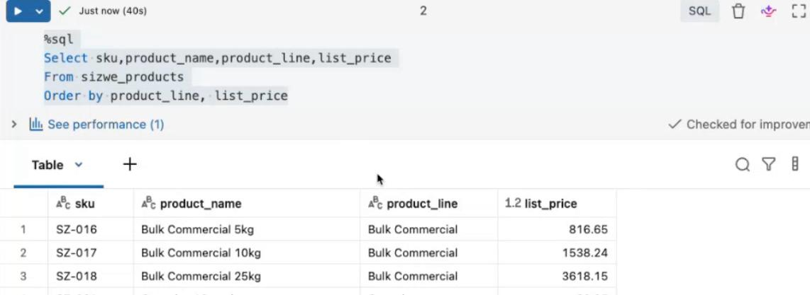
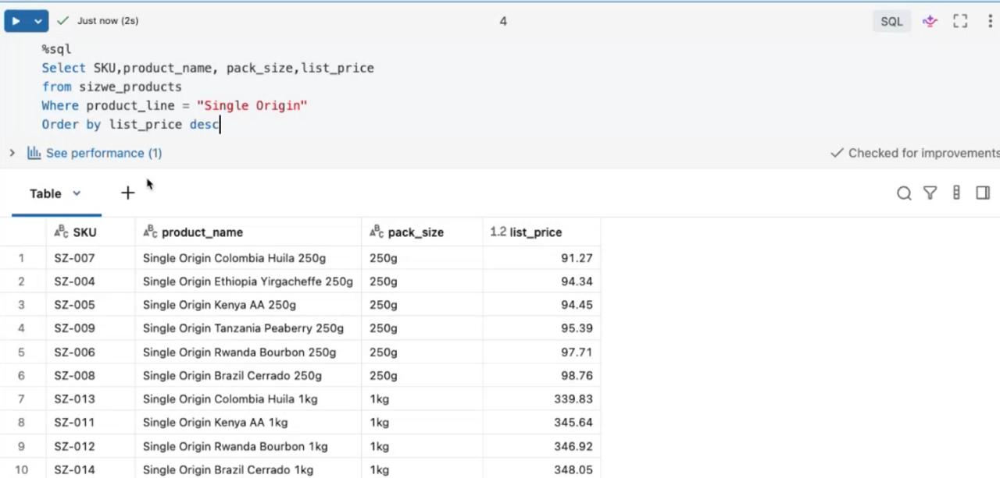
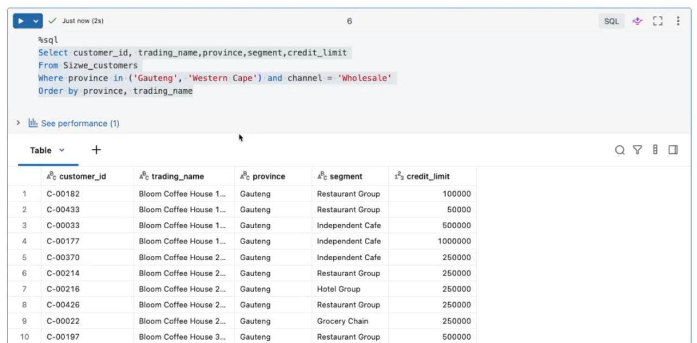
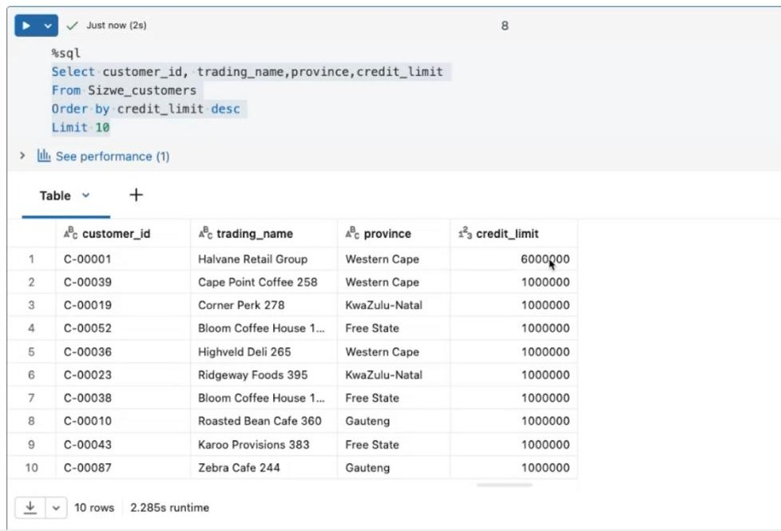
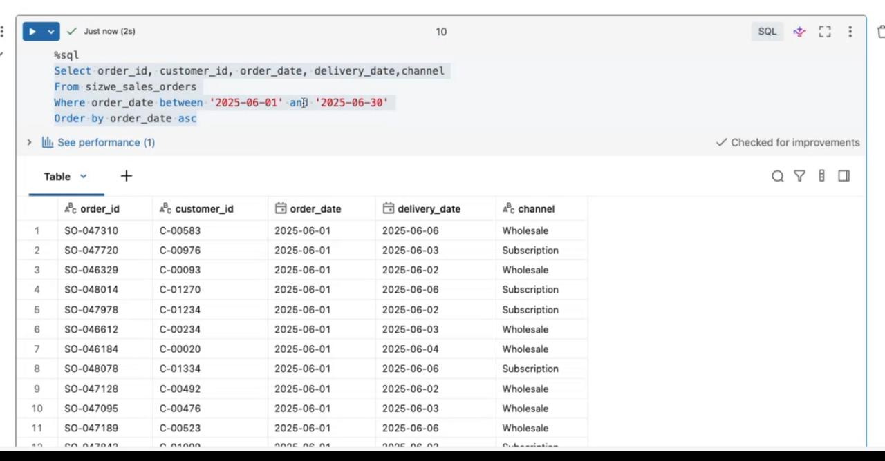
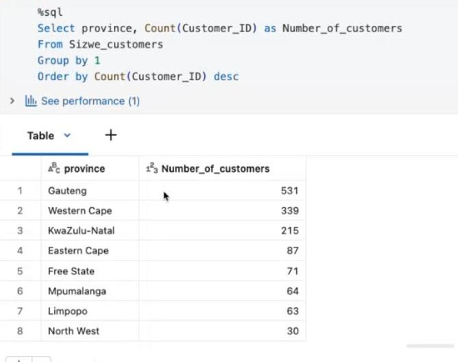
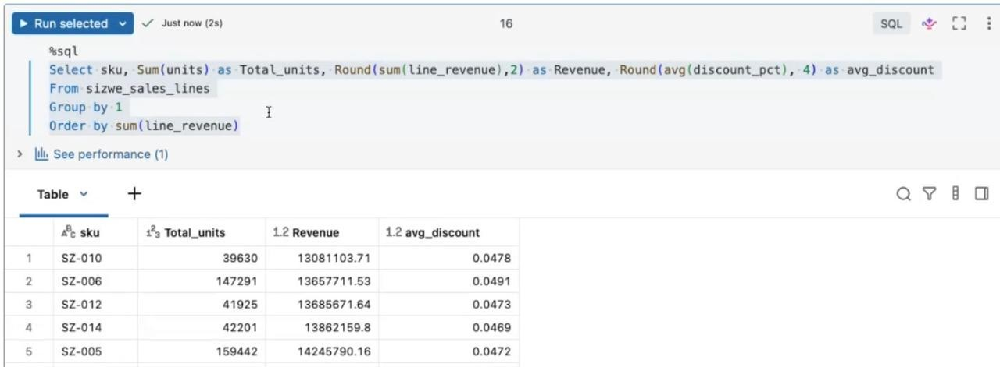
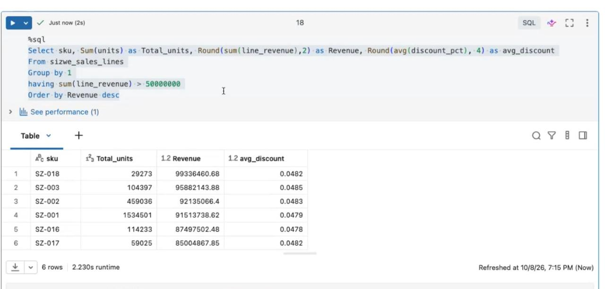
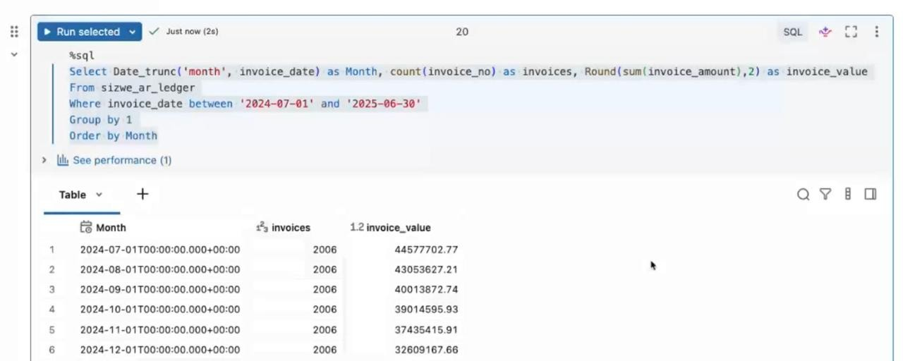

## Witle Academy SQL Class Exercise

## 🗺️ SQL Class Exercise overview:
Selecting and Filtering. Aggregation. Joins. Subqueries and CTEs. Window Functions

## 20 Questions

# Table of Contents
###### Part A - Selecting and Filtering
###### Part B - Aggregation
###### Part C - Joins
###### Part D - Subqueries and CTEs
###### Part E - Window Functions

## 📦 The dataset
The full dataset contains 9 CSV files.

| File | Rows | Description |
| ----------------------- | ------- | ---------------------------------------------------- |
| `customers.csv` | 1,400 | One row per customer - name, channel, segment, province, credit limit, assigned sales,representative  |
| `products.csv` | 23 | One row per SKU - product line, pack size, list price, unit cost  |
| `sales_orders.csv` | 45,144 |  One row per order - customer, order date, delivery date, channel, sales representative |
| `sales_lines.csv` | 168,172 | One row per order line - SKU, units, unit price, discount, line revenue, cost of goods  |
| `ar_ledger` | 48,144 |  One row per customer invoice - amount, due date, amount settled, settlement date |
| `reps.csv` | 18 | Sales representatives - territory, monthly target |
| `rep_visits.csv` | 9,400 | Visits made by sales representatives to customers, with the outcome |
| `trade_promotions` | 640 | Promotional support given to a customer on a SKU |
| `vendors.csv` | 74 | Suppliers - type, payment terms |

## How the tables connect.

• sales_orders.customer_id → customers.customer_id

• sales_orders.order_id → sales_lines.order_id

• sales_lines.sku → products.sku

• sales_orders.rep_id and customers.rep_id → reps.rep_id

• ar_ledger.customer_id → customers.customer_id

• rep_visits.customer_id and trade_promotions.customer_id → customers.customer_id

 
## Part A - Selecting and Filtering

######  Question 1 - Every product on the price list 
Nomsa in Finance wants the current price list. Return the SKU, product name, product line and list price 
for every product, sorted by product line and then by price. 
###### Answer 1 - Every product on the price list 

###### Question 2 - One product line only 
A customer has asked what single-origin coffees Sizwe sells. Return the SKU, product name, pack size 
and list price for every product in the Single Origin line, most expensive first. 
###### Answer 2 - One product line only 

###### Question 3 - Wholesale customers in two provinces 
The sales manager is planning a trip through Gauteng and the Western Cape. Return the customer ID, 
trading name, province, segment and credit limit for every Wholesale customer in either of those two 
provinces. Sort by province, then trading name. 
###### Answer 3 - Wholesale customers in two provinces 

###### Question 4 - The ten largest credit limits 
Credit control wants to review the biggest exposures first. Return the ten customers with the highest 
credit limit, showing their ID, trading name, province and limit. 
###### Answer 4 - The ten largest credit limits 

###### Question 5 - Orders in a single month 
Return every order placed in June 2025, showing the order ID, customer ID, order date, delivery date 
and channel, oldest first. 
###### Answer 5 - Orders in a single month 

## Part B - Aggregation

###### Question 6 - Customers per province 
How many customers does Sizwe have in each province? Return the province and the count, largest 
first. 
###### Answer 6 -  Customers per province 

###### Question 7 - Performance by SKU 
For each SKU, return the total units sold, the total revenue, and the average discount percentage. Sort 
by revenue, highest first. Round revenue to two decimals and the average discount to four. 
###### Answer 7 - Performance by SKU 

###### Question 8 - Only the SKUs that matter 
Take the previous query and keep only the SKUs with total revenue above R50 million. Also return how 
many order lines each one appears on. 
###### Answer 8 - Only the SKUs that matter 

###### Question 9 - Invoicing by month 
For FY2025 only (1 July 2024 to 30 June 2025), return the number of invoices raised each month and 
their total value. One row per month, in date order.
###### Answer 9 - Invoicing by month 

## Part C - Joins

###### Question 10 - Orders with the customer name 
The order table stores a customer ID, which nobody can read. Return the twenty most recent orders 
showing the order ID, order date, customer trading name, province and channel. 
###### Answer 10 - Orders with the customer name 

###### Question 11 - Revenue by product line 
Product line lives on products; revenue lives on sales_lines. Return total units and total revenue for 
each product line, largest first. 
###### Answer 11 - Revenue by product line 

###### Question 12 - Who has never had promotional support? 
Return every customer with a count of the trade promotions they have received - including the 
customers who have received none. Show the twenty with the fewest. 
###### Answer 12 - Who has never had promotional support? 

###### Question 13 - Revenue by province 
Province is on customers, the order is on sales_orders, and the money is on sales_lines. Return the 
number of orders and the total revenue for each province, largest first.
###### Answer 13 - Revenue by province 

## Part D - Subqueries and CTEs

###### Question 14 - Customers above the average credit limit 
Return every customer whose credit limit is above the average credit limit across all customers. Show ID, 
trading name, province and limit, largest first. 
###### Answer 14 - Customers above the average credit limit

###### Question 15 - The ten biggest customers 
Using a CTE to total revenue per customer first, return the top ten customers by all-time revenue with 
their trading name, province and channel. 
###### Answer 15 - The ten biggest customers 

###### Question 16 - Customers no rep has ever visited 
Return every customer who has never appeared in rep_visits. Show their ID, trading name, channel 
and province.
###### Answer 16 - Customers no rep has ever visited 

## Part E - Window Functions

(Calculating across a set of rows without collapsing them.) 

###### Question 17 - Ranking customers 
Return the top fifteen customers by all-time revenue with a rank column alongside. Show trading name, 
province, revenue and rank. 
###### Answer 17 - Ranking customers

###### Question 18 - The top three in each province 
Return the three highest-revenue customers in each province - twenty-four rows in total. Show 
province, trading name, revenue and the position within the province. 
###### Answer 18 - The top three in each province 

###### Question 19 - Month-on-month movement 
Return monthly revenue for the whole period, with the previous month's revenue alongside it and the 
percentage change between them. One row per month, in date order.
###### Answer 19 - Month-on-month movement 

## Part F - Set operations 

###### Question 20 - One list of everyone Sizwe trades with 
Finance wants a single list of every party Sizwe transacts with - wholesale customers and vendors 
together. Return a type label ('Customer' or 'Vendor'), the ID, the name, and one detail column (province 
for customers, vendor type for vendors). Sort by type, then name. 
###### Answer 20 - One list of everyone Sizwe trades with

## 🔍 Key insights

----

## 📬 References

🔗[DAX function reference](https://learn.microsoft.com/dax/)

📘[Nova Retail Group — Sales Analytics by Clarence Mantiya](https://github.com/Clarence-Mantiya/test-project2/blob/main/README.md?plain=1) for Github layout

---

## ⭐ Let's Connect

- 💼 LinkedIn: https://www.linkedin.com/in/kgolagano-naomi-selebano/
- 📧 Email: kgolaganonaomi1@gmail.com

